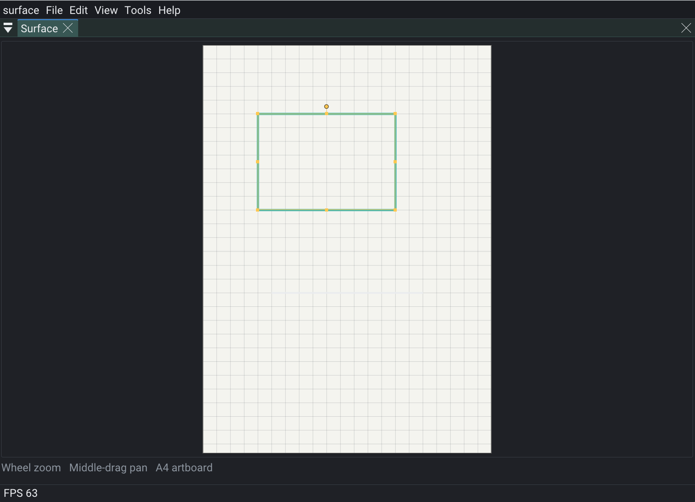

# rigArtboards

Shared editing surface for RigKit editors that work in millimetre space.

**Artboard** = a named rect (`CArtboard` in **rigPlotComponent**). This pack draws and edits those boards: pan/zoom under the cursor, click/marquee select, selection gizmo, numeric transform fields.

## Dependencies

- **rigPlotComponent** — `CBedView`, `CArtboard`, `CPathEditSelection`
- **rigVectorEditor** — `scalePath` / `rotatePath` / `translatePath`
- **rigImGui** — ImGui draw list / input

## Public headers (keep narrow)

| Header | Role |
|--------|------|
| `SurfaceView.h` | Pan, zoom-under-cursor, fit, draw board list |
| `SurfaceXform.h` | Transient gesture state (`SurfaceDrag` / `SurfaceXform`) |
| `SurfaceSeam.h` | Shell pickables, overlay callbacks, apply hook |
| `SurfaceGizmo.h` | 8-handle + rotate-stem selection gizmo |
| `SurfaceNumeric.h` | X/Y/W/H/rotate fields for the selection |
| `SelectionBounds.h` | Union bbox across layers |
| `PathfinderPanel.h` | Shared Pathfinder Shape Modes + Pathfinders (`IWindow`) |
| `AlignPanel.h` | Shared Align & Distribute (`IWindow`, Selection / Artboard) |

Shells keep content drawing and undo APIs; the gizmo emits transforms through the apply hook. Pathfinder / Align take a mutate hook for undo.

[API/docs](https://rigkid.github.io/rigArtboards/)
